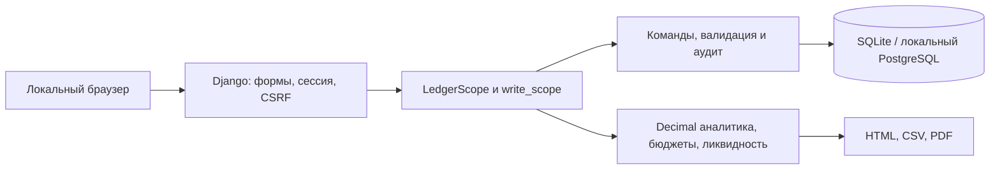

# Архитектура и модель финансового приложения

## Постановка и границы

Приложение ведёт управленческий учёт денежных потоков в рублях: счета, фактические поступления/расходы, планы платежей, бюджеты, переводы, сверки и отчётность. Это не бухгалтерский баланс и не банковский клиент. Фактическое обследование конкретного предприятия не проводилось; перечисленные ниже AS IS и TO BE являются учебными предположениями, которые требуется согласовать при включении в отчёт о реальной организации.

AS IS: операции в отдельных таблицах, разрозненные справочники, ручная сверка остатков и расчёт плана/факта; возможны повторные импорты и изменение классификации. TO BE: единая рабочая область, проверяемый CSV с предварительным просмотром, разграничение прав, точные суммы, журнал и воспроизводимый документ. Демоистория вымышлена и создаётся отдельно от личных записей.

## Компоненты

Запуск: run_local.py применяет миграции и поднимает один loopback-процесс. main.py предоставляет команды Django. Основная SQLite остаётся в каталоге проекта; секрет разработки, окружение и база не входят в Git. Зависимости зафиксированы в requirements.txt. Новая установка и отдельная браузерная проверка описаны в ACCEPTANCE.md.

## Данные

- Organization и OrganizationMembership задают общую область, OrganizationInvitation — ограниченное по времени приглашение.
- BankAccount, CashCategory, Counterparty и CashProject принадлежат личному владельцу либо организации.
- CashTransaction ссылается на счёт/статью и необязательные контрагента/проект той же области.
- PlannedPayment хранит намерение; проведённый платёж связан с одной защищённой фактической операцией.
- ExpenseBudget задаёт уникальный лимит статьи расходов за месяц.
- CashTransfer связывает два различных счёта одной области; влияет на остатки, не на внешние потоки.
- AccountReconciliation сохраняет остаток учёта и вручную введённой выписки на выбранную дату. Старый снимок не переписывается после поздней корректировки.
- ImportBatch сохраняет проверенные строки и SHA, TransactionReceipt — приватное содержимое документа, LedgerEvent — автора и действие.
- Feedback хранит обращения. DemoDataset является техническим маркером и не включён в число предметных таблиц.

В схеме 16 предметных и одна техническая таблица приложения, отдельно от служебных таблиц Django. Точный список полей/таблиц выгружается scripts/audit_requirements.py в reports/requirements-audit-v1.json. Миграции являются источником SQL-структуры, seed_demo — безопасным источником воспроизводимых вымышленных данных.

## Права и команды

| Роль области | Просмотр / выгрузка | Финансовые изменения | Участники и настройки |
|---|---|---|---|
| Руководитель, viewer | Да | Нет | Нет |
| Финансовый специалист, editor | Да | Да | Нет |
| Администратор, admin | Да | Да | Да |

Личный владелец управляет только своим учётом. Глобальный staff управляет аккаунтами и обращениями; этот признак сам по себе не открывает чужие финансовые записи. Клиентские идентификаторы фильтруются через область; межобластные связи отклоняются. Отозванное членство проверяется повторно внутри команды. Администратор-владелец организации не может случайно убрать собственные административные права.

write_scope блокирует организацию и пользователя в одном порядке. Изменение и LedgerEvent фиксируются одной транзакцией; ошибка аудита откатывает запись. Реальная проверка конкуренции на PostgreSQL подтверждает однократное проведение плана. SQLite не доказывает поведение row locks. Импорт защищён SHA, перевод — UUID и проверкой совпадения содержимого; повторное ручное создание обычной операции пока следует проверять по журналу, серверной защиты от повторной отправки этой формы ещё нет.

## Расчёты и документы

Поступления и расходы определяются направлением статьи. Остаток за период учитывает начальные суммы счетов и факты до начала периода. Переводы сохраняют общий остаток, но изменяют остаток каждого счёта; сверка и календарь ликвидности их учитывают. Денежное хранение и агрегаты описаны в MONEY.md. В SQLite арифметика над TEXT и встроенный SUM денежных колонок не применяются.

CSV-экспорт защищён от формул; предварительный просмотр импорта ограничен по размеру и числу строк. PDF строится под блокировкой области, с экранированием текста и встроенным кириллическим шрифтом с лицензией. Приватные PDF/TXT привязаны к операции и не отдаются через публичный каталог. Календарь ликвидности — детерминированный сценарий внесённых планов, не вероятностный прогноз.

## Приёмка и открытые критерии

69 тестов прошли на SQLite (один PostgreSQL-сценарий пропущен) и полностью на локальном PostgreSQL16.14. Отдельно выполнены чистая установка и настоящий Chrome157: формы, перевод, PDF, desktop1440/mobile390. Шесть снимков просмотрены. Это не полный кроссбраузерный аудит.

Количественный аудит считает Python AST-инструкции без docstring/test/migration и непустые строки HTML/CSS без комментариев. Получено 1857 смешанных единиц; это консервативный технический показатель, а не согласованный комиссией стандарт логической строки. Норма 2000 по этому методу ещё не достигнута. Дальнейшие изменения должны закрывать реальные сценарии, включая выписку отдельного счёта и защиту ручного ввода от повторной отправки; раздувание исходников недопустимо. История коммитов проверяется отдельно в PROGRESS.md.

Для итогового отчёта остаются согласование AS IS/TO BE с реальной организацией, оформление ТЗ/иллюстраций по шаблону и окончательная сверка критериев руководителем.
